**Republished:** Microsoft commissioned this three-part article series from me, and it was first published on CodeProject in June 2022. CodeProject has since closed, so I'm sharing it here. This is the version I submitted; the published one had light edits. Tool and action versions reflect mid-2022.
{: .notice--info}

**The series:** [Part 1: Introduction to GitOps](/gitops1/) · [Part 2: GitOps with Terraform and GitHub](/gitops2/) · [Part 3: GitOps Provisioning with GitHub Actions](/gitops3/)


In this article, we build upon what we learned in the previous article by showing how to construct a CI/CD pipeline that provisions changes that we merge into our Terraform plan via pull request.

Step by step, we'll set up GitHub Actions that first validate the updated Terraform plan, then run the plan and provision Azure infrastructure.

Then we'll prove the pipeline works by changing the plan in a pull request, and watch those changes result in Azure infrastructure being deployed.

## Prerequisites

This is a hands-on tutorial that requires the following setup beforehand:

- Azure subscription ([Free trial here](https://azure.microsoft.com/en-gb/free/))
- Azure CLI installed ([How to install](https://docs.microsoft.com/en-us/cli/azure/install-azure-cli))
- Terraform installed locally* ([Download](https://www.terraform.io/downloads))
- PowerShell
- An empty repository on GitHub ([Instructions here](https://docs.github.com/en/repositories/creating-and-managing-repositories/creating-a-new-repository))

\* The Terraform download is just a single binary file, not an installer. You will need to copy it to somewhere in your execution path.

If you’ve skipped the previous article in this series, you can clone the complete code from the [repository](https://github.com/benbhall/gitopsdemo-terraform-azure) via your favourite Git UI or on the command line:

```bash
git clone https://github.com/benbhall/gitopsdemo-terraform-azure.git
```

When you have created your Azure account, login to the [portal](https://portal.azure.com/) and head for the Subscriptions section by searching in the bar at the top of the page. Take a note of the Subscription ID assigned to it – you will need it later.

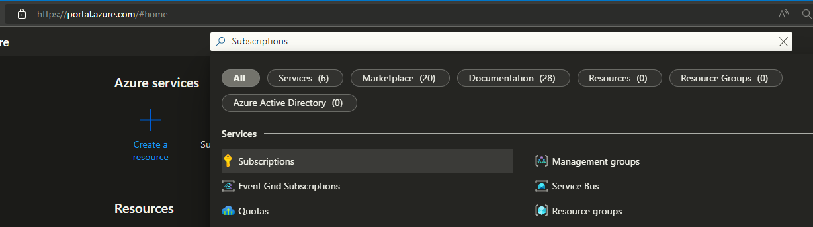

The complete code for this article is [available here](https://github.com/benbhall/gitopsdemo-terraform-actions) and also included throughout to follow along.

## Step 1: Setup the Backend

Terraform needs somewhere to persist its state file – a backend - we will be using Azure Blob Storage. As a resource that Terraform itself depends on, we do need to provision ourselves.

In a new PowerShell terminal, authenticate against Azure (use the account you signed up for the trial with):

```bash
az login
```

Create a resource group. You are free to change the region but it shouldn’t make any difference to follow along here with `uksouth`:

```bash
az group create -n gitopsdemo-tfstates-rg -l uksouth
```

Create a storage account:

```bash
az storage account create -n gitopsdemostore -g gitopsdemo-tfstates-rg -l uksouth --sku Standard_LRS
```

Create a storage container in that account:

```bash
az storage container create -n gitopsdemotfstates --account-name gitopsdemostore
```

## Step 2: Create a Service Principal

‘Service Principal’ is just a fancy name here, for an account that the GitHub Action can use to authenticate itself with Azure to access the storage account we just made, and create all our new resources.

In the same PowerShell terminal, execute the following code, replacing `<subscription-id>` with the one you recorded earlier.

```bash
az ad sp create-for-rbac --name gitopsdemo-tf-sp --role Contributor --scopes /subscriptions/<subscription-id> | ConvertFrom-Json
```

Make a note of the values output, as you will need to add these in the next step.

## Step 3: Store the Secrets in GitHub

Three of the values from step 2 map as follows with secrets that we need to set (the fourth secret is your subscription ID again).

| **GitHub Action Secret Name** | **Service Principal Create Output** |
|---|---|
| AZURE_AD_CLIENT_ID | `appId` |
| AZURE_AD_CLIENT_SECRET | `password` |
| AZURE_AD_TENANT_ID | `tenant` |
| AZURE_SUBSCRIPTION_ID | Subscription ID recorded earlier |

Store these as [encrypted secrets](https://docs.github.com/en/actions/security-guides/encrypted-secrets) in your GitHub repository by visiting your repository on the GitHub website, navigating to **Settings -> Secrets -> Actions**, and clicking **New repository secret**.

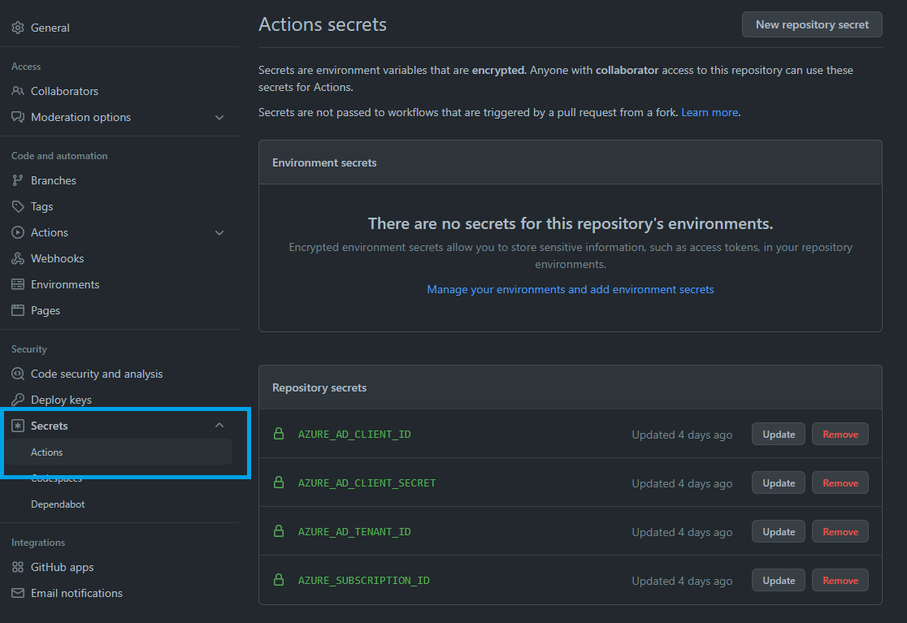

## Step 4: Configure the Backend in Terraform

During the `init` phase, Terraform will look for a backend configuration in your code so that it knows where to store the state file. In your **main.tf**, add the new config to the top of the `terraform` section:

```hcl
terraform {
  backend "azurerm" {
     resource_group_name  = "gitopsdemo-tfstates-rg"
     storage_account_name = "gitopsdemostore"
     container_name       = "gitopsdemotfstates"
     key                  = "gitopsdemo.tfstate"
  }
```

If you used the script above to create the storage account for Terraform state, you won’t need to change any of these values.

## Step 5: Build a GitHub Action Workflow

A YAML file for GitHub Actions can look a little overwhelming if you’re new to them, so we’ll break it up here. But if you do get stuck, the complete file is available in the [repository](https://github.com/benbhall/gitopsdemo-terraform-actions/blob/main/.github/workflows/main.yml).

GitHub Actions looks for YAML files in the folder `.github/workflows`. The code in those files specifies what events to listen for and what actions to take. Actions are made up of jobs, with each job being a series of steps.

### Step 5.1: Create the YAML file

You can do this on the GitHub website but it is better practice to work locally, then commit and push changes up. Don’t worry about Git branches at this point – we can just work on `main`.

Start by creating a folder in the root of your repository called `.github`, then inside that, another folder `workflows`. Inside the `workflows` folder, create a new file: **main.yml**.

Git ‘stage’ the new file, commit the change and push it up to GitHub in your UI or using the following commands:

```bash
git add main.yml
git commit -m "Add empty action file"
git push
```

Get into the habit of pushing changes up regularly!

### Step 5.2: Set events that trigger the workflow

Add the following lines to the top of `main.yml` to control when and how the workflow will run.

This workflow will trigger on any push or pull request events against the `main` branch. For a complete list of events that trigger workflows [refer to the docs](https://docs.github.com/en/actions/using-workflows/events-that-trigger-workflows).

```yaml
on:
  push:
    branches: [ main ]
  pull_request:
    branches: [ main ]
  workflow_dispatch:
```

The last line will ensure we can still run the workflow manually from the Actions tab on the GitHub website.

### Step 5.3: Add the job

Under the config we have so far in `main.yml`, add a job called `build`. We’ll start by pulling the secrets into environment variables the Terraform Azure provider will look for when authenticating in Azure. We’ll also set the working directory to the repository root but you can keep your Terraform files in a subdirectory and point there.

```yaml
jobs:
  build:
    runs-on: ubuntu-latest
    env:
      ARM_CLIENT_ID: ${{ secrets.AZURE_AD_CLIENT_ID }}
      ARM_CLIENT_SECRET: ${{ secrets.AZURE_AD_CLIENT_SECRET }}
      ARM_SUBSCRIPTION_ID: ${{ secrets.AZURE_SUBSCRIPTION_ID }}
      ARM_TENANT_ID: ${{ secrets.AZURE_AD_TENANT_ID }}
   
    defaults:
      run:
        working-directory: .
```

### Step 5.4: Checkout and Setup Terraform

We need to checkout our repository so the workflow can access our Terraform. We also need to make sure we have the Terraform CLI downloaded and configured. We’ll do this by adding our first two steps under the code we just added:

```yaml
  steps:
      - uses: actions/checkout@v3
      - uses: hashicorp/setup-terraform@v2
```

This makes use of a GitHub’s action `checkout@v3` and an action from Hashicorp. The latter defaults to fetching the latest version of Terraform, but where a specific version is required, this can be configured (see [usage documentation](https://github.com/hashicorp/setup-terraform)).

### Step 5.5: Terraform steps

The mandatory steps for Terraform to provision our resources in Azure are **init**, **plan**, and **apply**. But we will be building a production-ready workflow that will gate the `terraform apply` provisioning step with a pull request process that has automated checks.

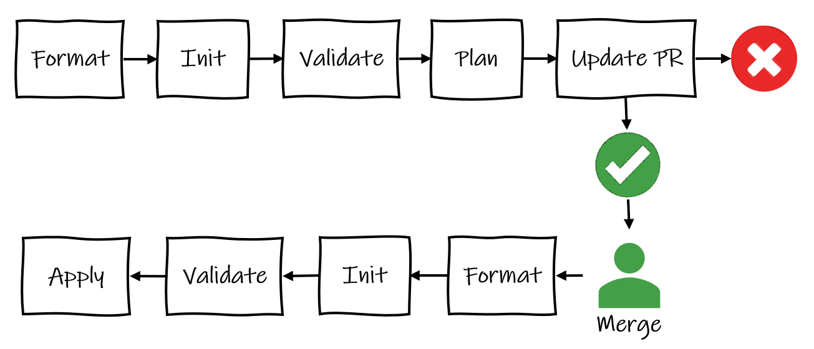

- **Format**: Enforce Terraform best practices and produce an error if the configuration is not formatted correctly.
- **Init**: Initialize the Terraform configuration/setup working directory.
- **Validate**: Without looking at actual resource / remote state, check the code syntax.
- **Plan**: Looking at actual remote state, determine what needs to be created, updated, or destroyed in order to move to the new/desired state in the code.

Add the following new steps:

```yaml
      - name: Terraform fmt
        id: fmt
        run: terraform fmt -check

      - name: Terraform Init
        id: init
        run: terraform init -input=false -migrate-state -force-copy

      - name: Terraform Validate
        id: validate
        run: terraform validate -no-color

      - name: Terraform Plan
        id: plan
        if: github.event_name == 'pull_request'
        run: terraform plan -no-color -input=false
        continue-on-error: true
```

Errors raised in these steps get added to the pull request as comments, failing the checks and preventing the changes from being merged into the `main` branch for provisioning resources. For this to happen we need to add another two steps:

```yaml
      - uses: actions/github-script@v6
        if: github.event_name == 'pull_request'
        env:
          PLAN: "terraform\n${{ steps.plan.outputs.stdout }}"
        with:
          github-token: ${{ secrets.GITHUB_TOKEN }}
          script: |
            const output = `#### Terraform Format and Style 🖌\`${{ steps.fmt.outcome }}\`
            #### Terraform Initialization ⚙️\`${{ steps.init.outcome }}\`
            #### Terraform Validation 🤖\`${{ steps.validate.outcome }}\`
            #### Terraform Plan 📖\`${{ steps.plan.outcome }}\`
            <details><summary>Show Plan</summary>
            \`\`\`\n
            ${process.env.PLAN}
            \`\`\`
            </details>
            *Pushed by: @${{ github.actor }}, Action: \`${{ github.event_name }}\`*`;
            github.rest.issues.createComment({
              issue_number: context.issue.number,
              owner: context.repo.owner,
              repo: context.repo.repo,
              body: output
            })
      - name: Terraform Plan Status
        if: steps.plan.outcome == 'failure'
        run: exit 1
```

I can’t take credit for this neat bit of code – it comes adapted straight from the [example](https://github.com/hashicorp/learn-terraform-github-actions/blob/main/.github/workflows/terraform.yml).

Lastly, we need an Apply step that will go ahead and provision the resource changes. In our workflow, we are triggering that from the merge to `main`.

```yaml
      - name: Terraform Apply
        if: github.ref == 'refs/heads/main' && github.event_name == 'push'
        run: terraform apply -auto-approve -input=false
```

## Step 6: Trying Out the Workflow

Create a new branch `bad-formatting-demo` locally in your Git UI, or on the command line with:

```bash
git checkout -b bad-formatting-demo
```

Break the formatting in **main.tf** – it should be enough if you just tab the `locals` block in a bit further.

Stage the updated main.tf, commit the change and push our new branch up to GitHub:

```bash
git add main.tf
git commit -m "Break formatting"
git push --set-upstream origin bad-formatting-demo
```

Navigate to your repository on the GitHub website and go to the **Pull requests** tab. It should have noticed your new changes and offer to **Compare & pull request** – click that button.

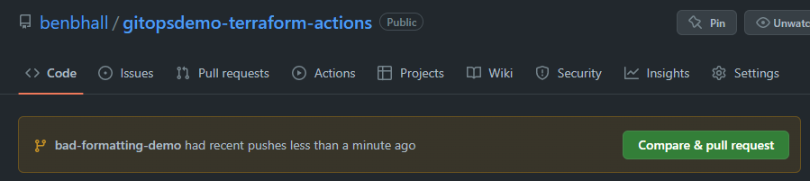

Then click **Create pull request**.

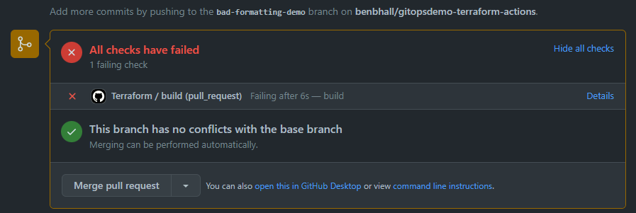

Click on **Details** to see the step that failed:

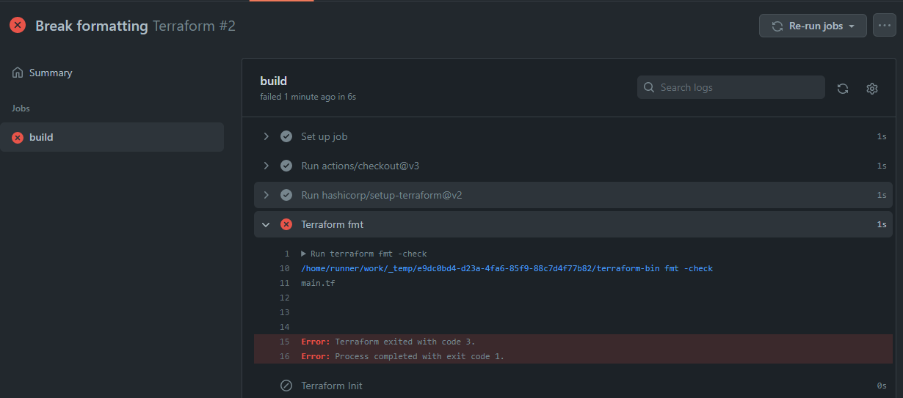

### Fixing the Error

Locally, on the command line inside the folder where our Terraform code is located, run the [Terraform format command](https://www.terraform.io/cli/commands/fmt):

```bash
terraform fmt
```

You will need to add `-recursive` if you have subfolders in your *own* future Terraform code.

This will automatically fix all formatting errors on your files.

Push up the fixed file. The PR checks will automatically run again. If everything else looks good in the other steps it will be ready to go ahead and **Merge pull request**.

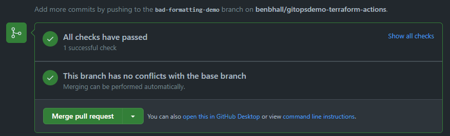

As shown in the diagram above, this will re-trigger the checks and, assuming they all still pass, it will go ahead and run the Apply step provisioning the resources in Azure:

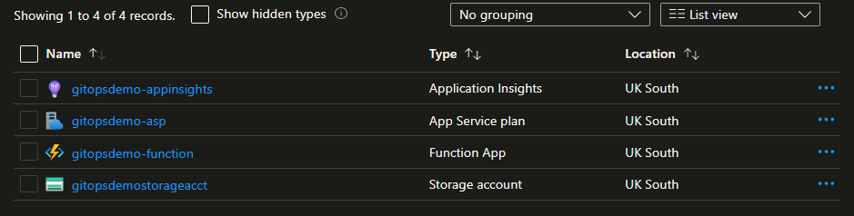

### Visibility of Changes to State

One thing we couldn’t see in the last run was how Terraform will show us the intended changes when it sits at the PR for code review.

Go ahead and remove the Application Insights resource on a new local branch, push it up to GitHub and open a new pull request.

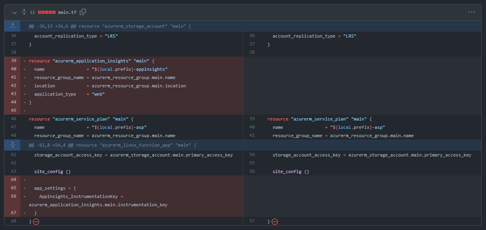

The checks should all pass but click on the **Show all checks -> Details** anyway, and expand the **Terraform Plan** section.

A code reviewer can easily see what changes to the current live state are being proposed in the pull request:

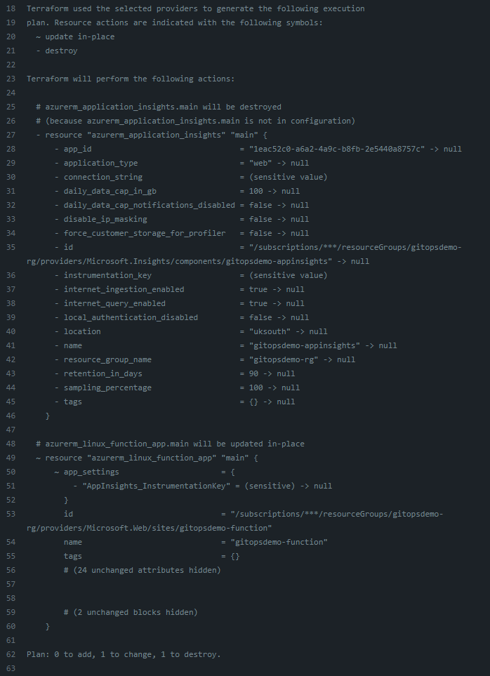

When we merge this change, triggering the workflow to run through again, to the Apply step, we can see the App Insights resource removed from our resource group in Azure.

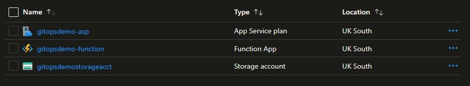

## Summary

In this article, we gave you hands-on experience constructing a CI/CD pipeline that provisions changes that have been merged into your Terraform plan via a pull request. We’ve demonstrated the use of automated checks to support the code review process in ‘gating’ deployments, and we had a go at the end-to-end process for making changes and seeing those changes in the live Azure resources.


**The series:** [Part 1: Introduction to GitOps](/gitops1/) · [Part 2: GitOps with Terraform and GitHub](/gitops2/) · [Part 3: GitOps Provisioning with GitHub Actions](/gitops3/)
