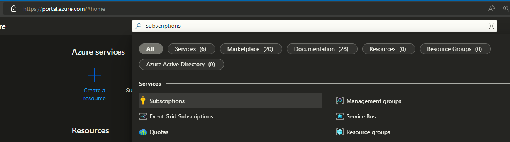
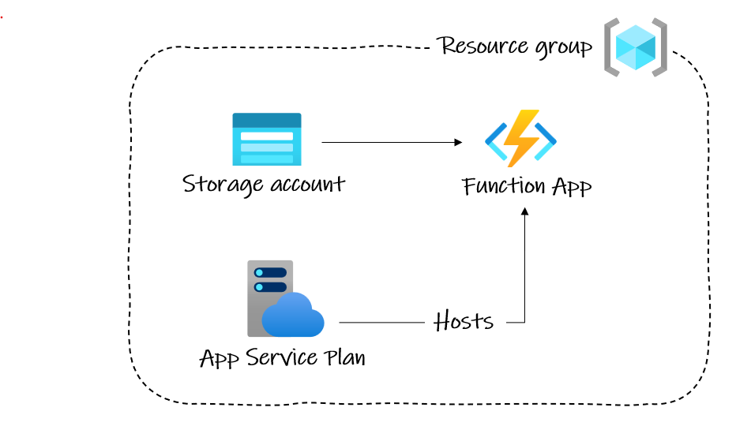
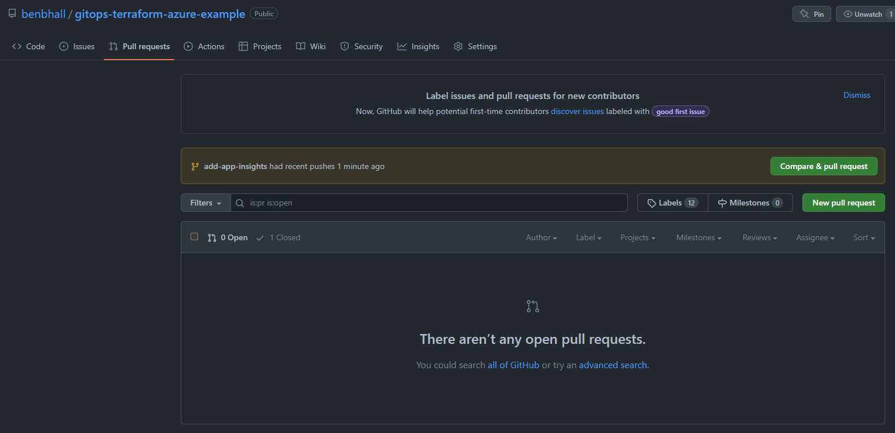
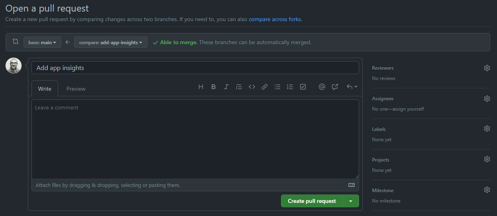
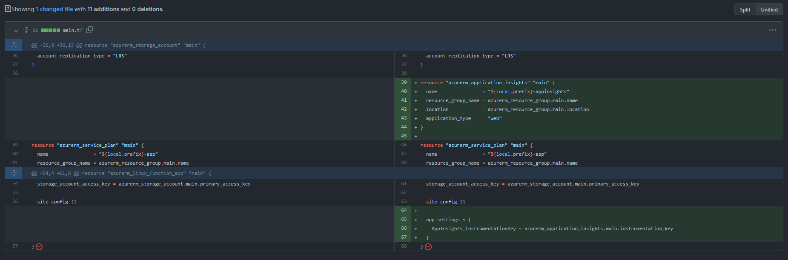
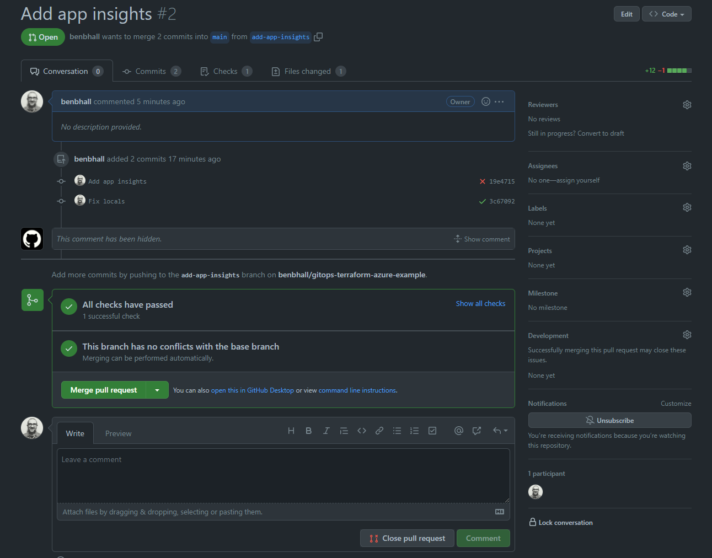

**Republished:** Microsoft commissioned this three-part article series from me, and it was first published on CodeProject in June 2022. CodeProject has since closed, so I'm sharing it here. This is the version I submitted; the published one had light edits. Tool and action versions reflect mid-2022.
{: .notice--info}

**The series:** [Part 1: Introduction to GitOps](/gitops1/) · [Part 2: GitOps with Terraform and GitHub](/gitops2/) · [Part 3: GitOps Provisioning with GitHub Actions](/gitops3/)


In the previous article, we looked at DevOps, a modern philosophy for working with people, processes, and tools to accelerate the pace of software development; how it has adopted the software development practices of CI (Continuous Integration) and Continuous Deployment (CD); and how it spawned the new concept of GitOps - where a type of source code called IaC (Infrastructure as Code) is stored in Git source control as the single source of truth about what infrastructure is currently deployed.

There are many tools for IaC, but Terraform has gained the most traction everywhere I have worked. Mainly because it ticks every box – even removing any need for additional configuration management (CM) tools such as Ansible in many use cases.

The primary function of Terraform is to provision infrastructure. Meaning, to deploy and manage the state of infrastructure. The Terraform workflow consists of:


1. **Write**: Make changes to the infrastructure code (performed by a person).
2. **Init**: Setup the working directory (performed by Terraform).
3. **Plan**: Determine what needs to be created, updated, or destroyed to move from the current stage in live, to the new/desired state in the code (performed by Terraform).
4. **Apply**: Make the changes to the live infrastructure (performed by Terraform).
5. **Destroy**: Remove live resources no longer required (performed by Terraform).

*Reference: [Terraform: Up & Running (O'Reilly)](https://learning.oreilly.com/library/view/terraform-up-and/9781098116736/preface01.html)*

In this article we will take the theory we learned in the first article and learn how to apply it in a real-world scenario, provisioning the infrastructure for an Azure Function App using Terraform. We will then look at how we can utilize a Git workflow – branching, committing changes and doing a code review on a pull request – as part of our GitOps processes.

## Prerequisites

This is a hands-on tutorial that requires the following setup beforehand:

- Azure subscription ([Free trial here](https://azure.microsoft.com/en-gb/free/))
- Azure CLI installed ([How to install](https://docs.microsoft.com/en-us/cli/azure/install-azure-cli))
- Terraform installed locally* ([Download](https://www.terraform.io/downloads))
- PowerShell ideally
- An empty repository on GitHub ([Instructions here](https://docs.github.com/en/repositories/creating-and-managing-repositories/creating-a-new-repository))

\* The Terraform download is just a single binary file, not an installer. You will need to copy it to somewhere in your execution path.

When you have created your Azure account, log in to the [portal](https://portal.azure.com/) and head for the Subscriptions section by searching in the bar at the top of the page. Take a note of the Subscription ID assigned to it – you will need it later.



The complete code is [available here](https://github.com/benbhall/gitopsdemo-terraform-azure) and also included throughout the article to follow.

## Step 1: Using the Azure Provider

Terraform is cloud-agnostic – it can provision infrastructure across many cloud services such as Azure, Amazon Web Services (AWS), and Google Cloud Platform (GCP). It can also be used to provision services from other SaaS providers and APIs, such as the IDaaS (Identity as a Service) vendor auth0, or observability service Datadog.

These plugins provided by services are called Terraform ‘providers’ A complete list of verified providers is available on the [Terraform Registry](https://registry.terraform.io/browse/providers).

A provider consists primarily, of:

- **Version number**: These typically follow semantic versioning so we know when to update.
- **Resources**: The new things we want to provision.
- **Data sources**: A way to access resources that already exist. For example, we might need to get the details of a Key Vault to fetch secrets.

For working with Azure, there are 3 providers:

- Azure RM – this is the basic provider that you will use to interact with Azure Cloud
- Azure Stack – similar for working with on-premises instances
- Azure Active Directory – deals with Azure AD exclusively

Create a new file called **main.tf** in the root folder of your repository, and add the following lines of code. Note, that required_providers are optional, but setting the version and source is strongly recommended.

```hcl
terraform {
  required_providers {
      azurerm = {
        source  = "hashicorp/azurerm"
        version = ">=3.0.0"
      }
    }  
}

provider "azurerm" {
  features {}
}
```

**Best practice tip**: For a large production system with lots of providers or provider versions, you should consider moving the providers to a separate file: provider.tf, to make them easier to manage.

## Step 2: Writing the Terraform Code

To deploy our [serverless function](https://docs.microsoft.com/en-us/azure/azure-functions/functions-overview) code for the very simple web request, we need to provision the infrastructure for an Azure Function App.

An Azure Function App also requires additional infrastructure:

- **Resource group**: *All* resources in Azure must be inside a Resource Group.
- **App Service plan**: Essentially, decides what you will pay for – what compute resources you want.
- **Storage account**: Necessary for Function operations.

So, we’ll need to deploy these too!



We want to set the regional location for the resources, as well as a common prefix for their names. In more complex production systems, keep these organized [in variable definition ‘tfvars’ files](https://www.terraform.io/language/values/variables). To keep this example simple and contained in a single **main.tf** file, we will use local variables.

Add the following to the top of the file:

```hcl
locals {
  location = "uksouth"
  prefix   = "gitopsdemo"
}
```

At the bottom of our **main.tf** file, under everything we have added so far, paste in the code for the infrastructure that we will need:

```hcl
resource "azurerm_resource_group" "main" {
  name     = "${local.prefix}-rg"
  location = local.location
  }

resource "azurerm_storage_account" "main" {
  name                     = "${local.prefix}storageacct"
  resource_group_name      = azurerm_resource_group.main.name
  location                 = azurerm_resource_group.main.location
  account_tier             = "Standard"
  account_replication_type = "LRS"
}

resource "azurerm_service_plan" "main" {
  name                = "${local.prefix}-asp"
  resource_group_name = azurerm_resource_group.main.name
  location            = azurerm_resource_group.main.location
  os_type            = "Linux"
  sku_name            = "Y1"
}

resource "azurerm_linux_function_app" "main" {
  name                       = "${local.prefix}-function"
  resource_group_name        = azurerm_resource_group.main.name
  location                   = azurerm_resource_group.main.location
  
  service_plan_id            = azurerm_service_plan.main.id
  storage_account_name       = azurerm_storage_account.main.name
  storage_account_access_key = azurerm_storage_account.main.primary_access_key

  site_config {}
}
```

That’s it for our Terraform.

We now have all of the infrastructure we need to deploy a Function App to Azure. Declared in a single file. We can use it to easily provision (or re-provision) the same resources across multiple environments, in a fraction of the time it would take to perform the task manually. All via automation if we wish, without any of the common risks, like configuration drift and inconsistencies.

Best of all, by declaring our infrastructure as code, we are on our way to practicing GitOps. We can now take advantage of Git developer tooling, including version history, branching, and pull requests with code reviews, to ensure the infrastructure described in the code matches what is actually provisioned in our live systems. Depending on the systems in place for developers at your organization, you might also link up your code changes with tools used to track project work such as Azure DevOps Boards.

## Step 3: Working with Git

Terraform greatly improves DevOps practices by tracking state. But problems with the state can, and do, occur. By using Git as the single source of truth for the current state of our infrastructure we can mitigate that risk.

Go ahead and push your changes up to GitHub – via the CLI or your favorite Git UI.

### The Code Review

An essential control that GitOps borrows from software development is the pull request - where we want someone to *manually* check changes made to the code. This is commonly referred to as a ‘code review’.

We’re going to add [Application Insights](https://docs.microsoft.com/en-us/azure/azure-monitor/app/app-insights-overview) to our Function App now. As with application development, we will do this on a separate branch to avoid breaking the code currently in live on *main*. We’ll only merge it into the main branch *after* it has been code reviewed.

Create a new branch ‘add-app-insights’ locally in your Git UI, or on the command line with:

```bash
git checkout -b add-app-insights
```

Add a new resource:

```hcl
resource "azurerm_application_insights" "main" {
  name                = "${local.prefix}-appinsights"
  resource_group_name = azurerm_resource_group.main.name
  location            = azurerm_resource_group.main.location
  application_type    = "web"
}
```

So that the Function App can talk to the Application Insights instance, add a new app setting to the function’s resource with the key:

```hcl
resource "azurerm_linux_function_app" "main" {
   
  …

  app_settings = {
    AppInsights_InstrumentationKey = azurerm_application_insights.main.instrumentation_key
  }
}
```

Stage the updated main.tf, commit the change, and push our new branch up to GitHub:

```bash
git add main.tf
git commit -m "Add app insights"
git push --set-upstream origin add-app-insights
```

Navigate to your repository on the GitHub website and go to the **Pull requests** tab. It should have noticed your new changes and offer to **Compare & pull request** – click that button.



The screen to open a PR is your opportunity to explain any complex changes to the person reviewing it. In our case, it’s a self-explanatory addition so we can leave the comments blank.



It’s also a very good time to have one last check of the changes you are asking to pull into the main branch. I can’t count the number of times I’ve caught a mistake at this point.



Click the button to **Create pull request** when you’re happy to proceed.

Another member or members of your team can then verify your code. When setting up the repository for a GitOps workflow, as with application code, it is a good idea to set rules to enforce the number of approvals required, who should approve, and other automated checks (which we can look at in the next article).



Then it can be merged into the main branch with **Merge pull request**.

We’ll look at using GitHub Actions to automatically deploy these changes to Azure in the next article.

## Summary

In this article, we gave you hands-on experience writing Terraform code to deploy some simple Azure infrastructure, and using the Git workflow used by software developers to ‘gate’ infrastructure changes to our *main* branch – with *main* being the source of truth for what the desired state of our infrastructure is.

In the next article we will construct a CI/CD pipeline that can use automated checks in addition to the code review process, and provision the resources to Azure.


**The series:** [Part 1: Introduction to GitOps](/gitops1/) · [Part 2: GitOps with Terraform and GitHub](/gitops2/) · [Part 3: GitOps Provisioning with GitHub Actions](/gitops3/)
