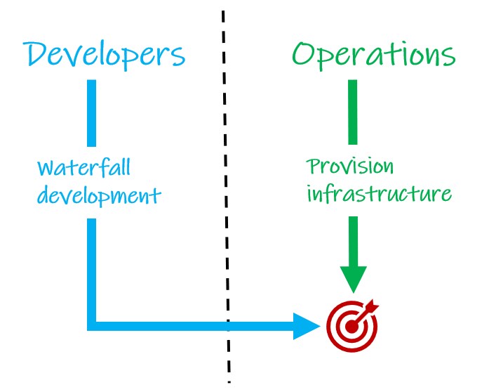
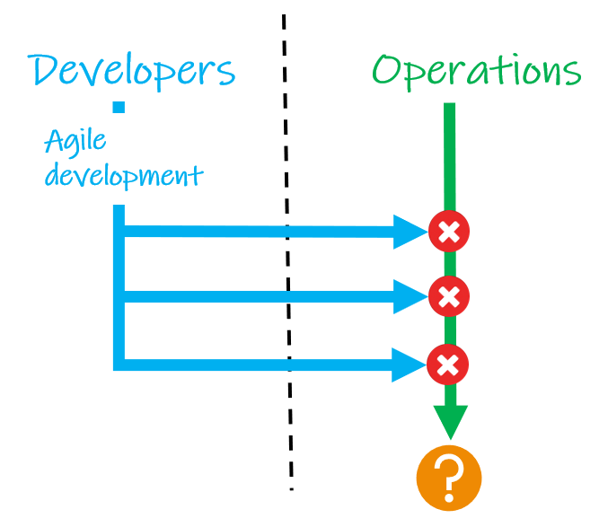
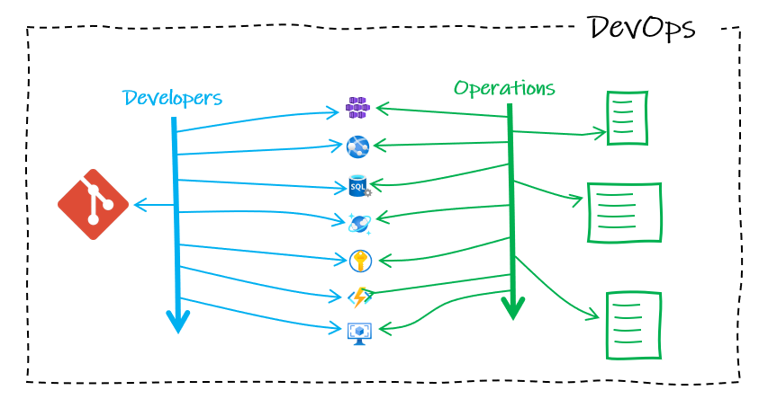
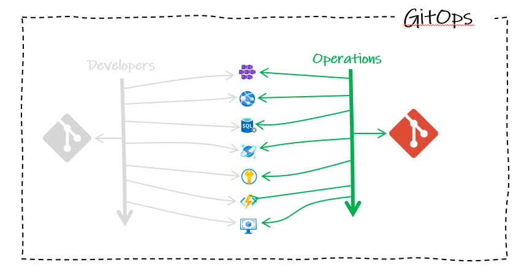
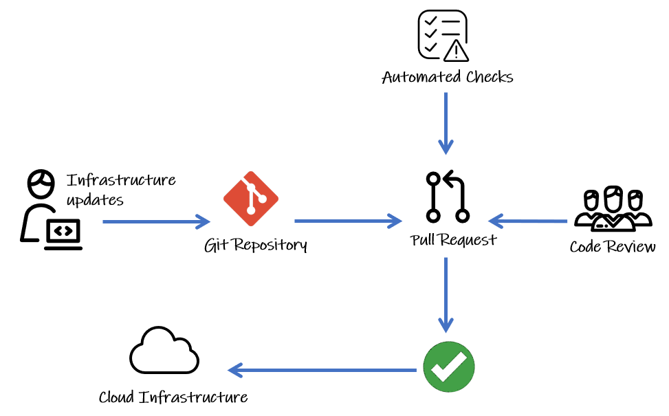

**Republished:** Microsoft commissioned this three-part article series from me, and it was first published on CodeProject in June 2022. CodeProject has since closed, so I'm sharing it here. This is the version I submitted; the published one had light edits. Tool and action versions reflect mid-2022.
{: .notice--info}

**The series:** [Part 1: Introduction to GitOps](/gitops1/) · [Part 2: GitOps with Terraform and GitHub](/gitops2/) · [Part 3: GitOps Provisioning with GitHub Actions](/gitops3/)


In the article series, we'll explain some GitOps theory and then get some hands-on practice using Terraform, Azure, and GitHub. We will start by taking a look at GitOps - defining the need, what it actually is, and how it relates to the term IaC (Infrastructure as Code) and the pipeline concepts of CI (Continuous Integration) and CD (Continuous Deployment).

In this article, we will look at the history of software engineering practices and how they have led to the evolution of GitOps.

## Once, There Was Waterfall

For a long time, we had waterfall – an approach where the entire software development lifecycle was completed as a single, large piece of work, and the first time the software was used in anger, was on release day. With such long cycles, it was a long time before development teams got feedback and a chance to release a new version.

This worked just fine for the methods of software distribution available at the time – shorter cycles would have been impractical. This way of working provided Operations teams with plenty of time to provision the infrastructure for launch day.

## Then Came Agile

Arguably the main benefit of adopting agile methodologies in software development, was the idea of making smaller changes and releasing much more frequently – something that was facilitated by the new methods of distribution becoming widely available – moving away from solid media.

This methodology was definitely capable of getting code out faster, but Operations teams were working with tools and practices that could not always support the increased frequency of changes.

## DevOps Became a Thing

This is one reason why DevOps evolved – to drive a culture where developer and operations teams work much more closely together. And working together, they were able to automate builds, tests, and deployments, to support the increased release cadence from agile.

The size and complexity of applications have grown though, with systems built from huge numbers of microservices, and the demands on those systems are growing too. As such, infrastructure solutions are going where there is the ability to scale and reduce infrastructure resources, dynamically, in response to loads. This is what the cloud does very well.

Developers had benefited greatly from working closely with Operations, but all these cloud services being fired up is a lot to manage, and it is easy with old methods, to lose track of what infrastructure we *have*, what infrastructure we *need*, and whether the two marry up.

## Then, There Was GitOps

In hindsight, it seems obvious. For operations activities to keep up with developer cadence, they should adopt the same DevOps best practices used for application development and apply them to automate the provision of infrastructure.

At the core of this approach is Git source control, used, just like software developers, as the single source of truth for what infrastructure is currently deployed. Layered on that we have three core components: IaC (Infrastructure as Code), Pull Requests, and CI/CD.

### Infrastructure as Code

The standout change with GitOps is the use of Git. Git is a version control system that tracks changes to code over time. To use Git, we now need to represent our infrastructure in code form. This is one of the three key components of GitOps – IaC (Infrastructure as Code) – where we use code to describe the desired state of our infrastructure. In this series of articles, we will be using Terraform and IaC that has gained a lot of traction in recent years.

### Pull Requests as a Change Gate

Operations teams use Git workflows to work collaboratively on our shared source of truth. A pull request is a key part of Git workflows. It is a way for someone working on a clone of a repository to request that changes they have made in their clone are pulled into the main repository.

When a pull request is opened, it is normal to require a code review. This is an opportunity for other team members to inspect the new code, write comments suggesting changes, and grant their approval – a repository will be set to block any incoming code without approval – a ‘gate’ for all changes to our infrastructure.

Since Git will keep a history of all changes, it also provides a clear audit log.

### Continuous Integration and Deployment

CI (Continuous Integration) is another best practice borrowed from DevOps. It refers to automating how we integrate code changes with a repository. It helps multiple contributors to merge changes into a shared, central repository, by reducing the risks of adverse effects through changes that break things. This is achieved with tools that run automatically to execute tests when new code is added, typically in a pull request. In our flow shown in the diagram above, we can see that our infrastructure updates are only going to be merged in from the pull request after 2 conditions are met:

1. Code review approved by the team
2. Automated checks (or tests) pass

CD (Continuous Deployment) refers to a setup whereby all new changes pulled into our repository are automatically deployed to production (if they pass the pull request checks). This is an ideal to aim for, which requires all your processes, particularly your tests, to be excellent. Some teams choose to gate production environments with manual approvals too. Whatever level of maturity your CD is at, a common theme is the ‘pipelines’ (or tools) for automating all of the infrastructure provisioning steps.

CD can also refer to Continuous Delivery – where the repository is always kept in a releasable state, even if you are not deploying every change. While your release rhythm is a matter of preference in application development, the shorter the release cycle, the smaller the changes are, reducing risk. A purist might argue that for GitOps, it is non-negotiable as the repository should reflect the current state of production. But we can argue that if the audit trail from the deployment pipeline to the repository is in place, it is always clear whether our repository is reflecting the current state or a future desired state at any point in time.

## A Quick Note on Push vs. Pull Deployments

GitOps deployments can either be push- or pull-based. They differ in the way they keep the environments in the desired state. Pull-based is preferred as it is more secure and offers better support for Continuous Delivery. But push-based is simpler to get started with and the way that Terraform is designed to work.

Push-based will be more familiar to those coming from application development. When the application code is updated in the repository, a build pipeline gets triggered that ultimately pushes the changes to the production environment(s). It wouldn’t automatically notice any changes made directly to environments.

Pull-based deployments are not triggered by code changes. We need an ‘operator’ service that continuously compares desired state in the repository code with the actual current state in the deployed infrastructure. If it finds changes, it pulls in the changes, updating the infrastructure to match the repository.

## Summary

GitOps provides a single, unified tool for an organization to manage both their infrastructure *and* application development; building on improvements to collaboration made with DevOps. There are many benefits, including:

- **Disaster recovery**: Redeploy any or all of your infrastructure rapidly. Or roll back and forward to any point in time in the Git log to deploy a particular desired state of your infrastructure.
- **Security:** Using Git means that all changes are logged in the history and change details can be recorded in pull requests and Git commit messages – answering those audit questions of the who, what and why for infrastructure changes. GitOps also reduces the risk of sharing login credentials – developers no longer need to have access to servers.
- **Self-documenting deployments**: All changes made to your environments go through your Git repository. You only have to look at the latest commit on your *main* branch to know exactly what is in production. No need to remote into servers to audit state.

In the next article, we will put theory into practice and write some IaC using Terraform, push it up to a Git repository on GitHub, and have a go at a simple workflow using a code review process with a pull request to merge infrastructure changes into our code.


**The series:** [Part 1: Introduction to GitOps](/gitops1/) · [Part 2: GitOps with Terraform and GitHub](/gitops2/) · [Part 3: GitOps Provisioning with GitHub Actions](/gitops3/)
